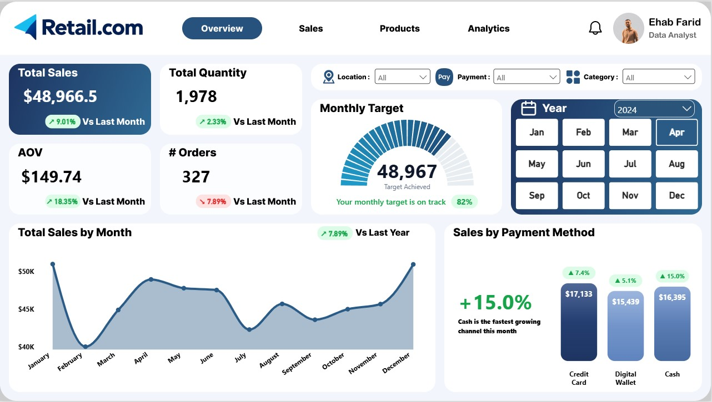
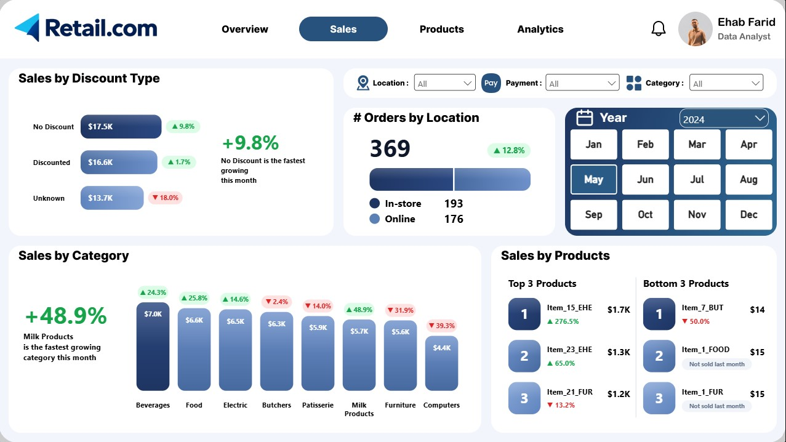
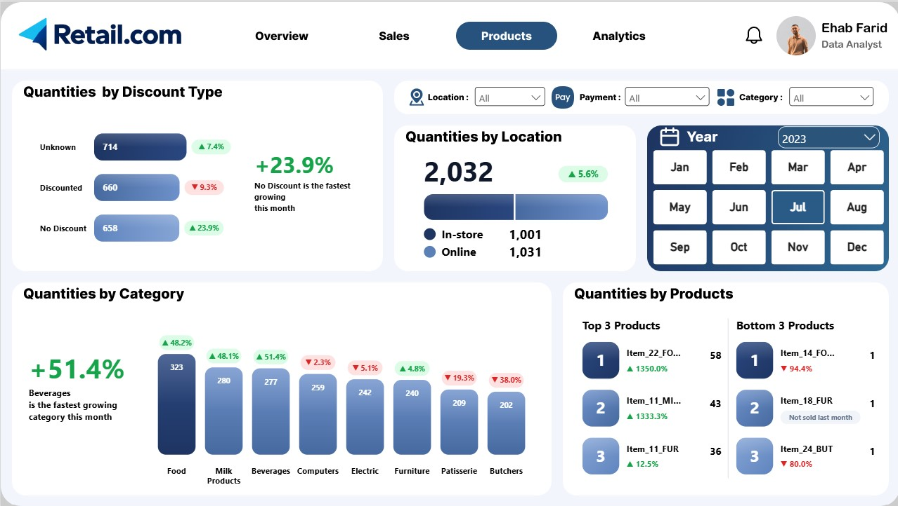
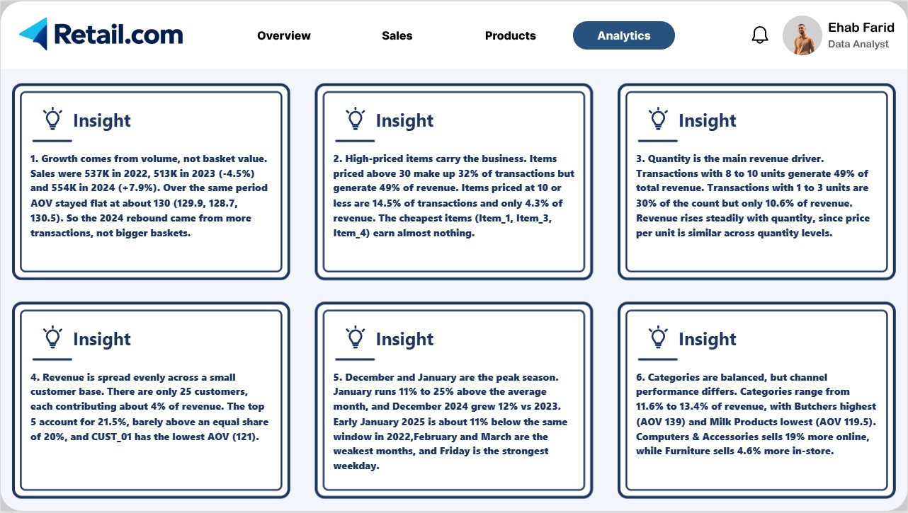
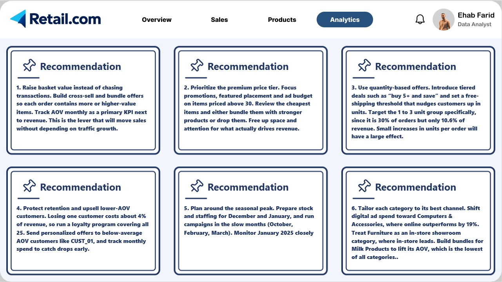

# Retail Store Sales Analysis

End-to-end analysis of retail store sales: data cleaning in **Python (pandas)**, then an interactive **Power BI dashboard** with sales, product and analytics pages that end in business recommendations.



## Project Overview

- **Dataset:** 12,575 transactions, 11 columns, from January 2022 to January 2025
- **Scope:** 8 product categories, 25 customers, 2 channels (In-store, Online), 3 payment methods (Credit Card, Digital Wallet, Cash)
- **Goal:** clean the raw data, then turn it into a dashboard that answers what drives sales and what to do about it

## Business Questions

- How are sales, quantity, orders and AOV changing month over month and year over year?
- Which categories, products and payment methods are growing or declining?
- How do discounts and sales channels (In-store vs Online) affect performance?
- What drives revenue: price, quantity, customers or seasonality?
- What should the business do next?

## Dashboard

The dashboard has four pages. Every page shares the same filters (Location, Payment, Category, Year, Month), and every metric is compared with the previous month. Text callouts such as "Cash is the fastest growing channel this month" update dynamically with the filters.

### 1. Overview

Total Sales, Total Quantity, AOV and Orders, a Monthly Target gauge, monthly sales trend vs last year, and sales by payment method.


### 2. Sales

Sales by discount type, orders by location, sales by category, and the top 3 and bottom 3 products by sales.



### 3. Products

Same structure as the Sales page, measured in quantities instead of revenue.



### 4. Analytics

Six flip cards. The front of each card shows an **insight** found in the data, and the back shows the matching **recommendation**.

**Front: Insights**



**Back: Recommendations**



## Key Insights and Recommendations

| # | Insight | Recommendation |
|---|---|---|
| 1 | Growth comes from volume, not basket value. Sales were 537K in 2022, 513K in 2023 (-4.5%) and 554K in 2024 (+7.9%), while AOV stayed flat at about 130. | Raise basket value with cross-sell and bundle offers, and track AOV monthly next to revenue. |
| 2 | High-priced items carry the business. Items priced above 30 are 32% of transactions but 49% of revenue. Items priced at 10 or less are 14.5% of transactions and 4.3% of revenue. | Focus promotions and ad budget on the premium tier, and review the cheapest items. |
| 3 | Quantity is the main revenue driver. Transactions with 8 to 10 units generate 49% of revenue, while 1 to 3 units are 30% of orders but only 10.6% of revenue. | Introduce quantity-based offers such as "buy 5+ and save" and target the 1 to 3 unit group. |
| 4 | Revenue is spread evenly across 25 customers, each contributing about 4%. The top 5 account for 21.5%. | Run a loyalty program and send personalized offers to below-average AOV customers. |
| 5 | December and January are the peak season. January runs 11% to 25% above the average month, and December 2024 grew 12% vs 2023. | Prepare stock and staffing for the peak, and run campaigns in the slow months. |
| 6 | Categories are balanced (11.6% to 13.4% of revenue), but channels differ. Computers & Accessories sells 19% more online, while Furniture sells 4.6% more in-store. | Tailor each category to its best channel and build bundles for Milk Products, which has the lowest AOV. |

## Data Cleaning (Python)

The full process is documented step by step in [`python/Data_Cleaning.ipynb`](python/Data_Cleaning.ipynb).

**Missing values found:**

| Column | Missing | % |
|---|---|---|
| Item | 1,213 | 9.65% |
| Price Per Unit | 609 | 4.84% |
| Quantity | 604 | 4.80% |
| Total Spent | 604 | 4.80% |
| Discount Applied | 4,199 | 33.39% |

**Approach:**

| Column | Method | Why |
|---|---|---|
| Item | Lookup from `Category + Price Per Unit`, after checking that each pair maps to exactly one item. A second pass ran after prices were recovered. | The pair is a verified unique key, so the lookup is exact, not a guess. |
| Price Per Unit | `Item + Category` lookup first, then `Total Spent / Quantity` as a fallback. | The rows with a missing price also had a missing item, so the fallback filled all 609. |
| Quantity | Most frequent quantity (mode) of the same item. | Quantity is a whole-unit count, so the mode keeps integers while the median can give 5.5. |
| Total Spent | `Price Per Unit × Quantity` | Both inputs were available after the previous steps. |
| Discount Applied | Missing values labeled `Unknown` | A missing value does not prove that no discount was applied. |
| Data types | `Transaction Date` to datetime, `Quantity` to nullable integer | Required for time-based analysis in Power BI. |

**Result:** 12,575 rows and 11 columns before and after, with no duplicate Transaction IDs, and 0 missing values in every column. Validation checks are included at the end of the notebook.

## Limitations

- **604 rows (about 4.8%) have estimated Quantity and Total Spent.** The same rows were missing both values, so the quantity was imputed with the item's mode and the total was calculated from it. Revenue figures include these estimates.
- **Discount Applied is unknown for 4,199 rows (33.4%)** and was kept as `Unknown` instead of being guessed.
- The price recovered from `Total Spent / Quantity` assumes the total has no discount applied. It matched the known item prices for every recovered row.
- Recommendations are based on revenue only. The dataset has no cost or margin data.
- The dataset has only 25 customers, so customer-level findings reflect this dataset.

## Project Structure

```
Retail_Store_Sales_Analysis/
├── data/
│   └── retail_store_sales.csv
├── python/
│   └── Data_Cleaning.ipynb
├── power_bi/
│   └── Dashboard.pbix
├── output/
│   └── Cleaned_Dataset.csv
├── images/
│   ├── Overview.jpg
│   ├── Sales.jpg
│   ├── Products.jpg
│   ├── Analytics_1.jpg
│   └── Analytics_2.jpg
└── README.md
```

## How to Run

1. Install the required libraries:
   ```
   pip install pandas numpy jupyter
   ```
2. Open `python/Data_Cleaning.ipynb` and run all cells. The cleaned file is saved to `output/Cleaned_Dataset.csv`.
3. Open `power_bi/Dashboard.pbix` in Power BI Desktop. If the data source path breaks, point it to `output/Cleaned_Dataset.csv`.

## Tools

Python (pandas, NumPy), Jupyter Notebook, Power BI

## Author

**Ehab Farid Mohammed** | Data Analyst
